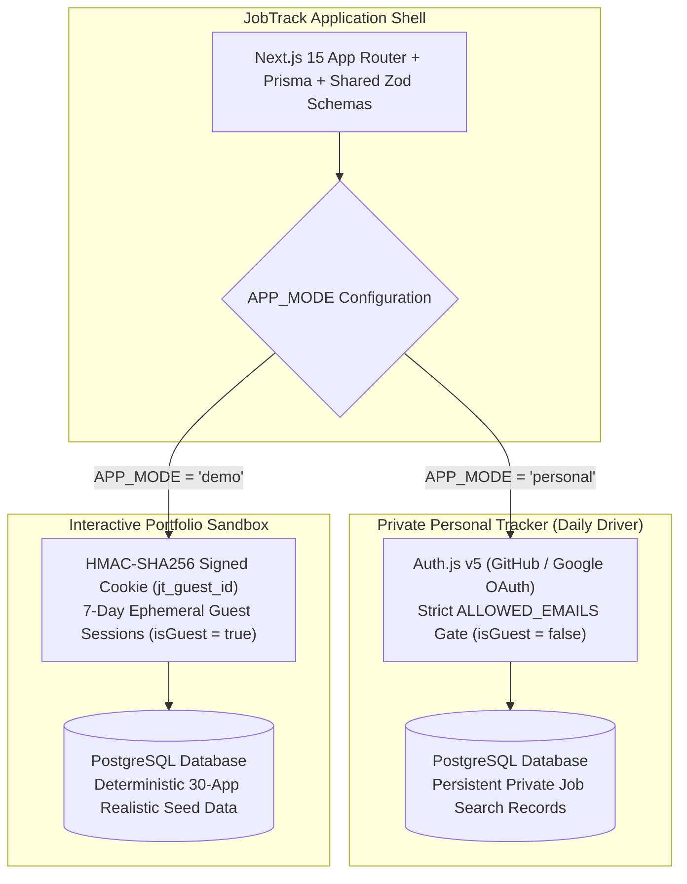
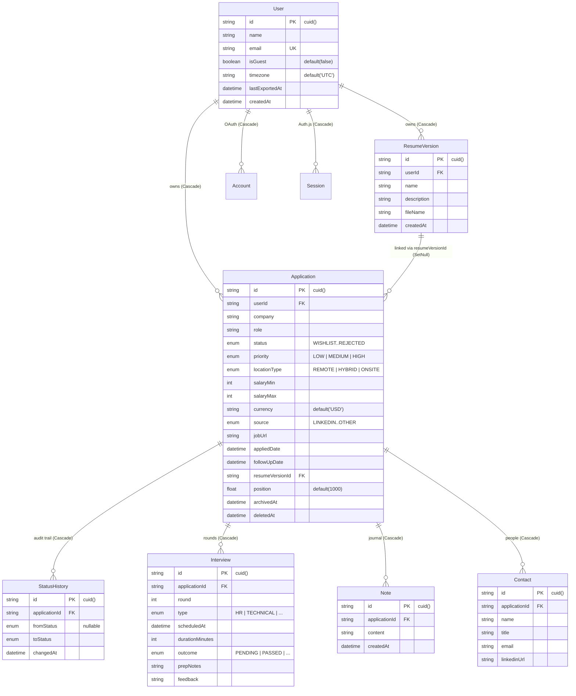
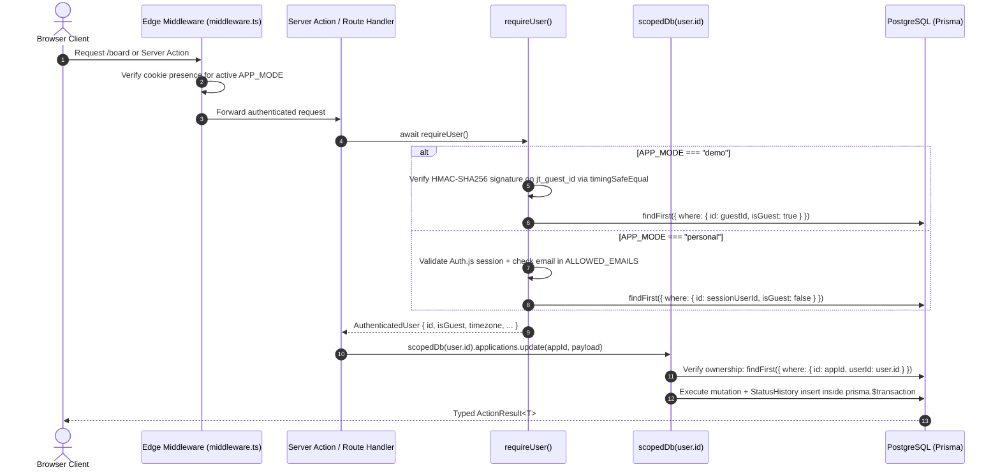

# JobTrack — System Architecture & Engineering Decisions

This document covers the internal architecture, data model, indexing strategy, request lifecycle, security controls, and Architectural Decision Records (ADRs) for **JobTrack**.

For quickstart, features, and deployment instructions, see [README.md](README.md).

---

## Table of Contents

1. [Operating Mode Architecture](#1-operating-mode-architecture)
2. [Database Schema & Entity-Relationship Model](#2-database-schema--entity-relationship-model)
3. [Composite Indexing Strategy](#3-composite-indexing-strategy)
4. [Request & Mutation Lifecycle](#4-request--mutation-lifecycle)
5. [Architectural Decision Records (ADRs)](#5-architectural-decision-records-adrs)
6. [Security & Multi-Tenant Isolation Model](#6-security--multi-tenant-isolation-model)
7. [Directory & Module Responsibilities](#7-directory--module-responsibilities)

---

## 1. Operating Mode Architecture

JobTrack was built as a personal daily driver to manage the author's own job search (`APP_MODE="personal"`), and includes a built-in interactive sandbox mode (`APP_MODE="demo"`) so anyone checking out the project can explore the full workflow with sample data.

Both modes share 100% of the application code, Zod schemas, database models, and UI components, while diverging strictly at the authentication, session, and housekeeping boundaries.



| Dimension | `APP_MODE="demo"` (Portfolio Sandbox) | `APP_MODE="personal"` (Private Daily Tracker) |
| :--- | :--- | :--- |
| **Purpose & Audience** | Interactive evaluation for recruiters & engineering managers | Primary developer / owner daily job search |
| **Data Scope** | Ephemeral guest data with automatic 7-day TTL cleanup | Persistent private records owned by authorized user |
| **Root Route (`/`)** | Marketing landing page + **"Try the Interactive Demo"** action | Redirects to `/board` (authenticated) or `/signin` |
| **Session Mechanism** | HTTP-only HMAC-SHA256 signed `jt_guest_id` cookie (`7d` TTL) | Auth.js v5 database sessions (`30d` TTL, HTTP-only) |
| **OAuth Sign-In (`/signin`)** | Disabled (redirects to `/`) | Enforced via GitHub/Google OAuth + `ALLOWED_EMAILS` check |
| **Initial State** | Auto-seeded with 30 applications across 90 days, 3 resumes, 56 status transitions, 10 interviews, 23 notes, 13 contacts | Clean empty account ready for real job search data |
| **Reset Sandbox** | Enabled (`resetDemoDataAction` wipes & reseeds caller's guest ID) | Hard-blocked on server (`Error: Forbidden`) & hidden in UI |
| **Scheduled Cleanup (`/api/cron/cleanup`)** | Deletes `User` rows where `isGuest = true` and `createdAt < now - 7d` + purges soft-deleted apps `> 30d` | Never touches `User` rows; only purges soft-deleted apps where `deletedAt < now - 30d` |

---

## 2. Database Schema & Entity-Relationship Model

The relational schema ([`prisma/schema.prisma`](prisma/schema.prisma)) is strictly normalized around `User` ownership with cascading foreign keys so deleting a guest or personal user cleanly removes all dependent records in a single operation.



---

## 3. Composite Indexing Strategy

| Model | Index Definition | Query Pattern Optimized |
| :--- | :--- | :--- |
| `Application` | `@@index([userId, deletedAt, archivedAt, status, position])` | Primary Kanban board and Table queries filtered by tenant, soft-delete state, archive state, and ordered by column `position`. |
| `Application` | `@@index([followUpDate])` | Overdue follow-up and calendar month queries. |
| `Application` | `@@index([deletedAt])` | 30-day soft-delete purge in `/api/cron/cleanup` and `/trash` listing. |
| `User` | `@@index([isGuest, createdAt])` | 7-day ephemeral guest cleanup in `/api/cron/cleanup`. |
| `StatusHistory` | `@@index([applicationId, changedAt])` | Chronological status timeline rendering and stage duration calculation. |
| `Interview` | `@@index([applicationId])`, `@@index([scheduledAt])` | Per-application round lookup and global chronological `/interviews` & `/calendar` queries. |

---

## 4. Request & Mutation Lifecycle

Every read and write flows through a deterministic 4-stage pipeline: Edge Middleware -> `requireUser()` -> `scopedDb(user.id)` -> `prisma.$transaction`.



---

## 5. Architectural Decision Records (ADRs)

### ADR-001: Float Midpoint Positioning with `0.001` Threshold Rebalancing
- **Problem**: Sequential integer ranks (`1, 2, 3, ...`) require updating `O(N)` rows on every Kanban card move, causing write amplification and lock contention.
- **Decision**: Store card order in a double-precision `Float` column (`position`, initialized at `1000, 2000, 3000, ...` in [`src/lib/kanban/positioning.ts`](src/lib/kanban/positioning.ts)). Moving a card between `prev` and `next` updates only the moved card to `(prev + next) / 2` (`O(1)` write).
- **Mitigation for Precision Exhaustion**: Repeatedly bisecting the exact same slot ~50 times can narrow the float gap. `calculateMovePosition()` flags `needsRebalance: true` whenever `Math.abs(next - prev) < 0.001` (`MIN_POSITION_GAP`). When triggered, `moveApplicationCardAction` transparently re-indexes that column back to `1000, 2000, 3000, ...` inside the same database transaction.

### ADR-002: URL-Driven State (`?app=ID` & Multi-Facet Search Params)
- **Problem**: Keeping active search/filter criteria, view mode (`board` vs `table`), or the open application drawer in local React state breaks deep links, shared URLs, page reloads, and browser `Back`/`Forward` history.
- **Decision**: Synchronize all filter state through [`src/lib/filters/application-filters.ts`](src/lib/filters/application-filters.ts) and drawer state through [`src/hooks/use-drawer-url.ts`](src/hooks/use-drawer-url.ts). Opening an application from the Kanban board, Table view, Notification Bell, Calendar grid, or Command Palette sets `?app=<id>` while preserving all active filter parameters.

### ADR-003: Historical Funnel & Stage Duration Derived from `StatusHistory`
- **Problem**: Computing conversion funnels solely from an application's *current* `status` miscounts any application that progressed through `APPLIED -> PHONE_SCREEN -> INTERVIEW` before ending in `REJECTED`.
- **Decision**: Every status transition writes an immutable `StatusHistory` record inside `prisma.$transaction` ([`src/server/actions/application.actions.ts`](src/server/actions/application.actions.ts)). The pure analytics engine ([`src/lib/analytics/calculations.ts`](src/lib/analytics/calculations.ts)) inspects the full `StatusHistory` chain and `Interview` records to compute accurate stage attainment and average days spent per stage.

### ADR-004: Timezone-Normalized Calendar-Day Overdue Evaluation
- **Problem**: Comparing raw UTC timestamps (`followUpDate < new Date()`) triggers premature "Overdue" badges for users in western timezones during evening hours and causes hydration mismatches between UTC servers and local browsers.
- **Decision**: Normalize dates into `YYYY-MM-DD` strings in the user's configured IANA timezone via `Intl.DateTimeFormat("en-CA", { timeZone })` ([`src/lib/dates/timezone.ts`](src/lib/dates/timezone.ts)). A follow-up is overdue if and only if its calendar date in the user's timezone is strictly earlier than today's calendar date in that same timezone, and the application is active (`status` not in `OFFER` / `REJECTED`, not archived, not soft-deleted).

---

## 6. Security & Multi-Tenant Isolation Model

1. **Mandatory `requireUser()` + `scopedDb(userId)` Layer**:
   - Implemented in [`src/server/auth/require-user.ts`](src/server/auth/require-user.ts) and [`src/server/db/scoped-queries.ts`](src/server/db/scoped-queries.ts).
   - Every query on `Application` and `ResumeVersion` binds `userId: user.id`. Every mutation on child entities (`Interview`, `Note`, `Contact`, `StatusHistory`) verifies parent application ownership first.
   - Tested against a live PostgreSQL instance in [`tests/integration/data-isolation.test.ts`](tests/integration/data-isolation.test.ts).

2. **Constant-Time HMAC-SHA256 Guest Cookie Signing**:
   - Implemented in [`src/server/auth/guest-cookie.ts`](src/server/auth/guest-cookie.ts).
   - `jt_guest_id` stores `<userId>.<hmac_sha256_signature>` signed with `AUTH_SECRET` and verified with `crypto.timingSafeEqual` to prevent guest ID forgery and timing attacks.

3. **Strict `ALLOWED_EMAILS` OAuth Allowlist**:
   - Implemented in [`src/auth.ts`](src/auth.ts).
   - In `personal` mode, `callbacks.signIn` normalizes the OAuth email and verifies membership in `ALLOWED_EMAILS` before allowing account creation or session issuance.

4. **Destructive Action Guards**:
   - `resetDemoDataAction` and `cleanupStaleGuestsAction` ([`src/server/actions/demo.actions.ts`](src/server/actions/demo.actions.ts)) are hard-blocked when `APP_MODE !== "demo"` and restricted to `isGuest: true`.
   - `restoreFullJsonBackupAction` ([`src/server/actions/import-export.actions.ts`](src/server/actions/import-export.actions.ts)) requires `0` active applications on the target account.
   - `deleteMyAccountAction` ([`src/server/actions/settings.actions.ts`](src/server/actions/settings.actions.ts)) requires typed `"DELETE"` confirmation.

5. **SSRF & DoS Hardening on `/api/metadata`**:
   - Implemented in [`src/server/security/ssrf-guard.ts`](src/server/security/ssrf-guard.ts), [`src/server/security/rate-limiter.ts`](src/server/security/rate-limiter.ts), and [`src/app/api/metadata/route.ts`](src/app/api/metadata/route.ts).
   - Allows only `http:` and `https:`.
   - Resolves DNS via `dns.promises.lookup(hostname, { all: true })` and rejects loopback (`127.0.0.0/8`, `::1`), RFC 1918 private ranges (`10.0.0.0/8`, `172.16.0.0/12`, `192.168.0.0/16`), link-local / cloud metadata (`169.254.0.0/16`, `fe80::/10`), CGNAT (`100.64.0.0/10`), unique local IPv6 (`fc00::/7`), IPv4-mapped IPv6 (`::ffff:...`), and internal TLDs (`.localhost`, `.local`, `.internal`, `.lan`, `.home`, `.corp`).
   - Enforces `redirect: "error"`, a `4000ms` `AbortController` timeout, a `256 KB` response stream cap, and a `10 req / 60s / userId` sliding-window rate limit.

---

## 7. Directory & Module Responsibilities

```text
src/
├── app/
│   ├── (app)/                          # Authenticated application shell routes
│   │   ├── board/                      # Kanban Board & URL-synced TanStack Table view
│   │   ├── calendar/                   # 7-column Month Grid & mobile chronological Agenda view
│   │   ├── dashboard/                  # Recharts Analytics Funnel, Stage Duration & Resume A/B Dashboard
│   │   ├── interviews/                 # Date-grouped global Interview Tracker
│   │   ├── settings/                   # Profile/Timezone, Resume Manager, CSV/JSON Portability & Danger Zone
│   │   ├── trash/                      # Recently deleted applications (30-day retention, Restore / Purge)
│   │   └── layout.tsx                  # App shell: Sidebar, Header, Backup Banner, Drawer, Command Palette, Shortcuts
│   ├── (auth)/signin/page.tsx          # Personal mode OAuth Sign-In page with allowlist error banner
│   ├── api/
│   │   ├── auth/[...nextauth]/route.ts # Auth.js v5 route handler
│   │   ├── cron/cleanup/route.ts       # Bearer CRON_SECRET protected housekeeping endpoint
│   │   └── metadata/route.ts           # SSRF-guarded, rate-limited OpenGraph job URL parser
│   └── page.tsx                        # Mode-aware root: Portfolio Landing Page (demo) or Redirect (personal)
├── components/
│   ├── applications/                   # ApplicationFormDialog, ApplicationDrawer & 5 drawer tab components
│   ├── board/                          # KanbanBoard, KanbanColumn, KanbanCard, ViewToggleBar, BoardView
│   ├── calendar/                       # CalendarMonthGrid, CalendarAgendaList, CalendarView
│   ├── dashboard/                      # StatCards, NeedsAttentionPanel, Funnel, Time, Source, Duration, Resume cards
│   ├── interviews/                     # InterviewFormDialog, InterviewsView
│   ├── layout/                         # AppSidebar, AppHeader, NotificationBell, CommandPalette, ShortcutsController
│   ├── settings/                       # GeneralSettingsCard, ResumeVersionsManager, CsvImportWizard, DataPortability
│   ├── table/                          # ApplicationsTable & TanStack ColumnDefs
│   └── ui/                             # shadcn/ui primitives
├── hooks/                              # useApplications, useDrawerUrl, useDebouncedAutosave, useMediaQuery
├── lib/
│   ├── analytics/calculations.ts       # Pure pipeline funnel, stage duration & resume A/B calculation engine
│   ├── calendar/calendar-events.ts     # Pure month grid & chronological agenda builder
│   ├── csv/parser.ts                   # PapaParse wrapper, header auto-mapper & row validator
│   ├── dates/timezone.ts               # IANA timezone normalization, overdue & 48h window evaluators
│   ├── filters/application-filters.ts  # URL search param parser, serializer & multi-facet filter/sort engine
│   ├── kanban/positioning.ts           # Float midpoint calculation & column rebalancing engine
│   └── seed/seed-guest-data.ts         # Deterministic 30-application realistic demo seed generator
├── schemas/                            # Shared client/server Zod schemas
└── server/
    ├── actions/                        # Server Actions (application, interview, note, contact, resume, settings, export, demo)
    ├── auth/                           # requireUser() & HMAC-SHA256 guest-cookie helpers
    ├── db/                             # Singleton Prisma client & mandatory scopedDb(userId) layer
    └── security/                       # SSRF IP/DNS guard & sliding-window rate limiter
```
